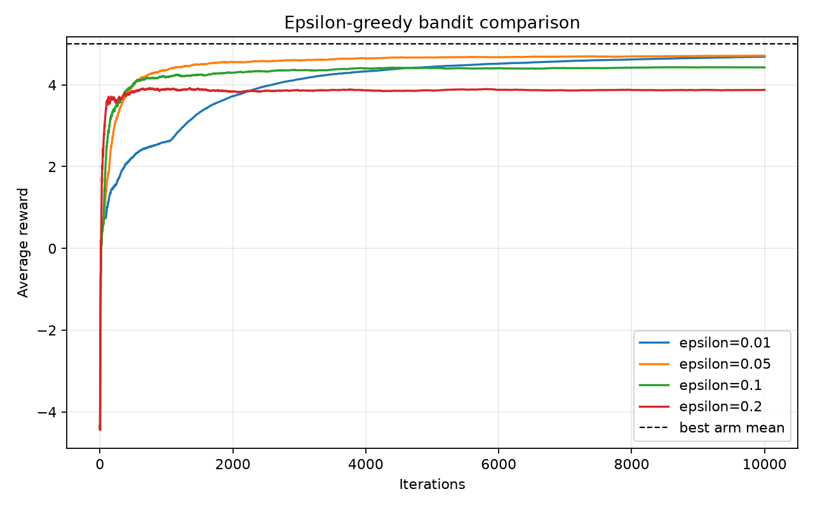

# 作业 1.1：Epsilon-greedy 多臂老虎机实验报告

## 1. 实验目的

研究 epsilon-greedy 方法在带随机奖励的多臂老虎机问题中的探索与利用平衡。通过比较不同 `epsilon` 的累计平均回报，观察探索概率对学习速度和最终性能的影响。

## 2. 问题设置

实验包含 11 个摇臂，编号为 `-5,-4,...,5`。摇臂 `k` 的奖励服从正态分布：

`R_k ~ N(mu_k, 1)`，其中 `mu_k=k`。

因此，真实期望回报最高的摇臂是 `k=5`，其期望奖励为 5。实验分别取 `epsilon=0.01、0.05、0.1、0.2`，每种设置运行 10000 次。程序固定随机种子 `20261002`，并将四条曲线绘制在同一张图中，同时绘制最优摇臂的真实均值 `5` 作为参考线。

## 3. 算法与实现

对每个摇臂维护价值估计 `Q(a)` 和选择次数 `N(a)`。初始时所有 `Q(a)=0`、`N(a)=0`。每一步按照 epsilon-greedy 规则选择动作：

- 以概率 `1-epsilon` 选择当前估计价值最大的摇臂；
- 以概率 `epsilon` 从其余摇臂中随机选择一个进行探索。

得到奖励 `R_t` 后，使用增量样本均值更新被选摇臂的价值：

`N(a) <- N(a)+1`

`Q(a) <- Q(a) + [R_t-Q(a)]/N(a)`。

同时记录从第 1 步到当前步的累计平均奖励：

`A_t = (R_1+R_2+...+R_t)/t`。

这里的 `Q(a)` 估计的是各摇臂的期望奖励，而 `A_t` 反映算法在整个运行过程中的平均收益。由于奖励服从随机分布，曲线可能出现上下波动；随着采样次数增加，价值估计通常会逐渐稳定。

## 4. 结果与分析

图中的黑色虚线是最优摇臂的真实期望奖励 5。纵轴不是某一步的即时奖励，而是截至当前迭代的累计平均奖励，因此曲线越接近 5，表示算法在较长时间内选择最优摇臂的比例越高。由于奖励带有标准差为 1 的随机噪声，曲线在早期有明显波动，后期逐渐变得平滑。

从实际曲线可以观察到以下现象：

1. `epsilon=0.01`（蓝线）在前约 2000 次迭代的上升明显较慢，累计平均奖励一度只有约 2～4。其原因是探索概率很小，早期如果偶然高估了次优摇臂，就会长时间重复利用该摇臂，缺少重新比较其他摇臂的机会。约 2000 次迭代后蓝线继续上升，在 10000 次迭代附近达到约 4.7，说明长期利用效率较高，但收敛速度受早期错误估计影响较大。
2. `epsilon=0.05`（橙线）在前几百次迭代内迅速升至 4 左右，随后稳定上升，在后期约为 4.7～4.8，最接近参考线。该设置保留了足够的探索来发现均值为 5 的最优摇臂，同时只以较低概率选择其他摇臂，因此在本次 10000 步实验中取得了最好的综合表现。
3. `epsilon=0.1`（绿线）也能较快达到 4 以上，并在后期稳定在约 4.4～4.5。它比 `epsilon=0.05` 更频繁地探索，所以发现最优摇臂的能力较强，但持续探索带来的次优动作会拉低长期累计平均奖励。
4. `epsilon=0.2`（红线）最早在约 300～600 次迭代达到 3.8～4.0，但之后基本停留在约 3.9，明显低于另外三条曲线。较大的探索概率使算法即使已经找到较优摇臂，也会频繁转而尝试其他摇臂，累计产生更多低奖励，从而降低长期平均收益。

因此，本次曲线体现出明显的探索—利用权衡：探索太少（`epsilon=0.01`）会造成早期错误选择的纠正速度慢，探索太多（`epsilon=0.2`）又会产生持续的探索成本。对本实验的单次 10000 步运行而言，`epsilon=0.05` 表现最好，`epsilon=0.1` 次之；不过这是固定随机种子下的一次实验，曲线的具体数值和排名仍可能随随机种子改变，不能将该结论直接推广到所有任务。

## 5. 结论

增量样本均值能够在不保存全部历史奖励的情况下估计摇臂价值，epsilon-greedy 则通过随机探索避免过早陷入次优选择。实验表明，合理的非零 epsilon 通常比纯贪心策略更可靠；但探索概率过大也会降低长期收益。因此，在有限实验步数下，应根据任务的噪声水平和运行时长选择合适的 epsilon。
