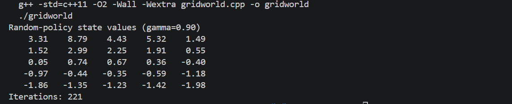

# 作业 1.2：Gridworld 随机策略状态价值

## 1. 实验目的

本实验实现 Sutton《强化学习》中的 Gridworld（P60）问题，使用动态规划方法计算均匀随机策略下各状态的价值函数，并以矩阵形式输出结果。

## 2. 环境与问题建模

环境为一个 `5×5` 网格，状态表示为 `(x,y)`，其中 `x` 为列坐标，`y` 为行坐标。每个状态有四个动作：向北、向南、向东和向西。采用均匀随机策略：

`pi(a|s) = 1/4`。

状态转移规则如下：

- 普通状态沿动作方向移动，奖励为 `0`；
- 如果动作越过边界，智能体停留在原状态，奖励为 `-1`；
- 特殊状态 A=`(1,0)` 无论采取何种动作，都转移到 `(1,4)`，即时奖励为 `10`；
- 特殊状态 B=`(3,0)` 无论采取何种动作，都转移到 `(3,2)`，即时奖励为 `5`。

折扣因子设置为 `gamma=0.9`。程序中的动态规划模型与环境的 `transition` 函数使用相同的转移规则，因此计算不依赖随机采样。

## 3. 算法描述

根据 Bellman 期望方程，均匀随机策略的状态价值满足：

`V_pi(s) = sum_a pi(a|s) [r(s,a) + gamma V_pi(s')]`。

由于每个动作的概率均为 `1/4`，本程序采用同步迭代计算：

`V_{k+1}(s) = 1/4 * sum_{a in A} [r(s,a) + 0.9 V_k(s'(s,a))]`。

具体步骤如下：

1. 将全部 25 个状态的初始价值设为 `0`。
2. 遍历每个状态和四个动作，根据环境规则得到后继状态和即时奖励。
3. 使用上一轮的 `V_k` 计算新的 `V_{k+1}`，暂存到独立数组中；一轮结束后整体替换旧数组，因此属于同步更新。
4. 记录本轮最大变化量
   `delta = max_s |V_{k+1}(s)-V_k(s)|`。
5. 当 `delta < 1e-12` 时停止迭代，否则继续计算。
6. 最终以两位小数输出价值矩阵。

采用同步更新可以避免同一轮中部分状态使用新值、部分状态使用旧值，算法形式直接对应 Bellman 期望迭代。由于 `gamma<1`，该迭代收敛到随机策略的唯一价值函数。

## 4. 运行方法

在项目根目录执行：

```bash
g++ -std=c++11 -O2 -Wall -Wextra \
  "作业1.2 gridworld/gridworld.cpp" \
  -o /tmp/gridworld

/tmp/gridworld
```

也可以进入作业目录后编译：

```bash
cd "作业1.2 gridworld"
g++ -std=c++11 -O2 -Wall -Wextra gridworld.cpp -o gridworld
./gridworld
```

## 5. 运行结果

程序运行 221 轮后满足收敛条件，输出如下：

```text
Random-policy state values (gamma=0.90)
    3.31    8.79    4.43    5.32    1.49
    1.52    2.99    2.25    1.91    0.55
    0.05    0.74    0.67    0.36   -0.40
   -0.97   -0.44   -0.35   -0.59   -1.18
   -1.86   -1.35   -1.23   -1.42   -1.98
Iterations: 221
```

矩阵每一行对应固定的 `y`，每一列对应固定的 `x`。例如第一行依次表示 `(0,0)` 到 `(4,0)` 的价值，第二个元素 `8.79` 对应特殊状态 A=`(1,0)`，第五个元素 `1.49` 对应特殊状态 B=`(3,0)` 的价值。A 的价值较高是因为从 A 出发每一步都能获得奖励 10 并跳转到第四行；B 的价值也受到奖励 5 的正向影响。靠近网格下边界的状态更容易在随机动作下撞墙并获得 `-1`，因此价值相对较低。

运行结果截图：



## 6. 结论

本实验通过 Bellman 期望迭代求得了均匀随机策略下的全部状态价值。结果体现了特殊状态的高回报和边界撞墙惩罚的影响，并与 Sutton《强化学习》P60 的参考结果一致，说明状态转移、奖励计算和动态规划实现正确。
